# 智能风扇图片与结构图集

以下 30 张图片提取自用户提供的智能风扇 Word 报告，按实物、硬件、选型和历史开发截图分类。备选模块不代表实际装配；图片中的控制值不代表实测 RPM。原报告的部分性能表述不作为本次新增测试结论。

[返回项目首页](../README.md) · [查看图片来源记录](images/sources.json)

## 系统总结构

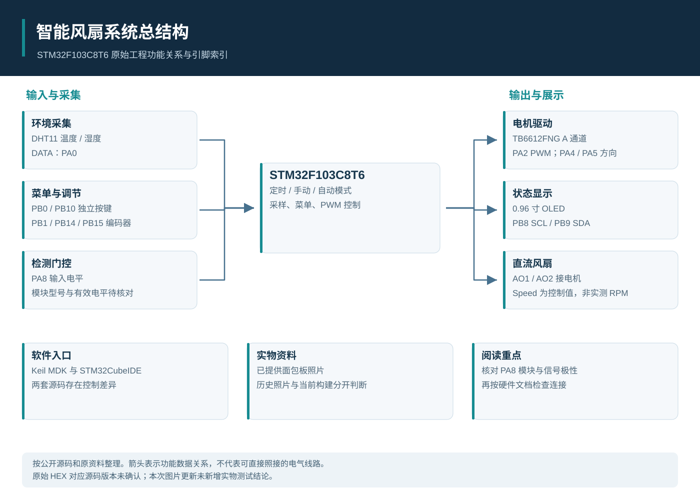

## 实物与操作照片

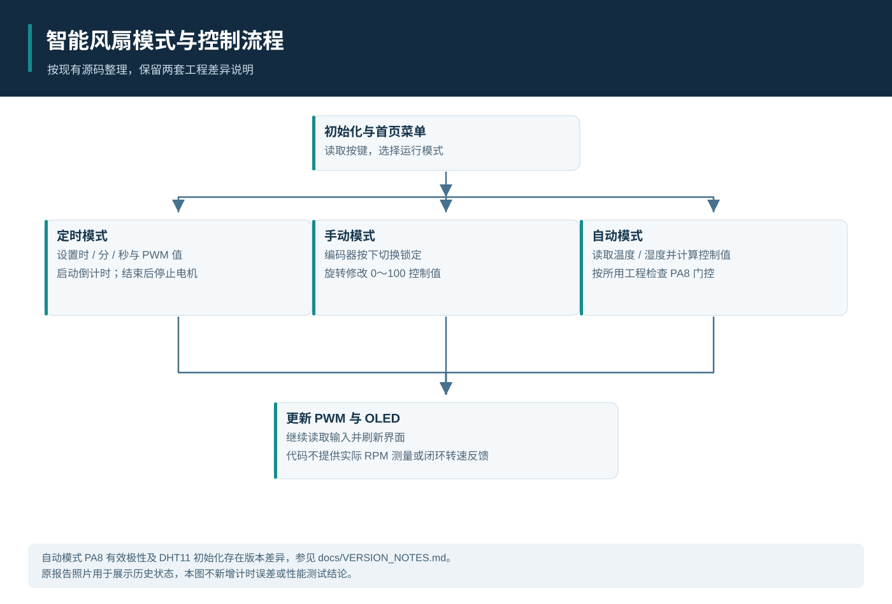

<table>
<tr>
<td width="50%" align="center" valign="top"><a href="images/gallery/fan-23.jpeg">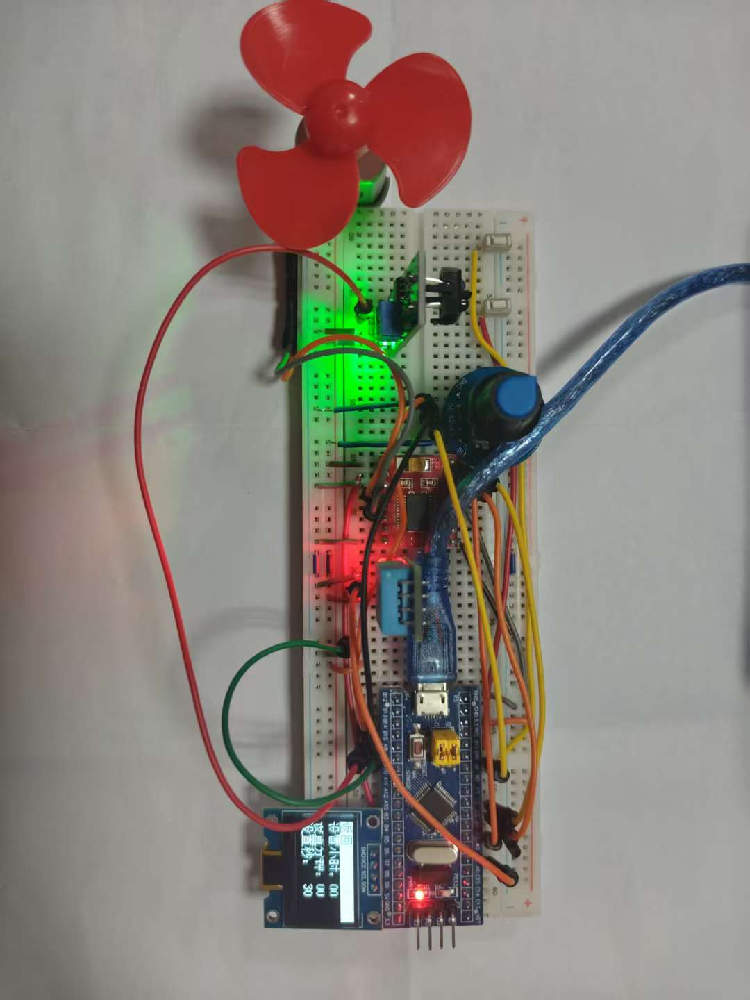</a> <strong>定时参数设置实拍</strong> 原报告标注为设置 30 秒的操作照片；不据此推出计时精度。 Word 原报告 · image23.jpeg</td>
<td width="50%" align="center" valign="top"><a href="images/gallery/fan-24.jpeg">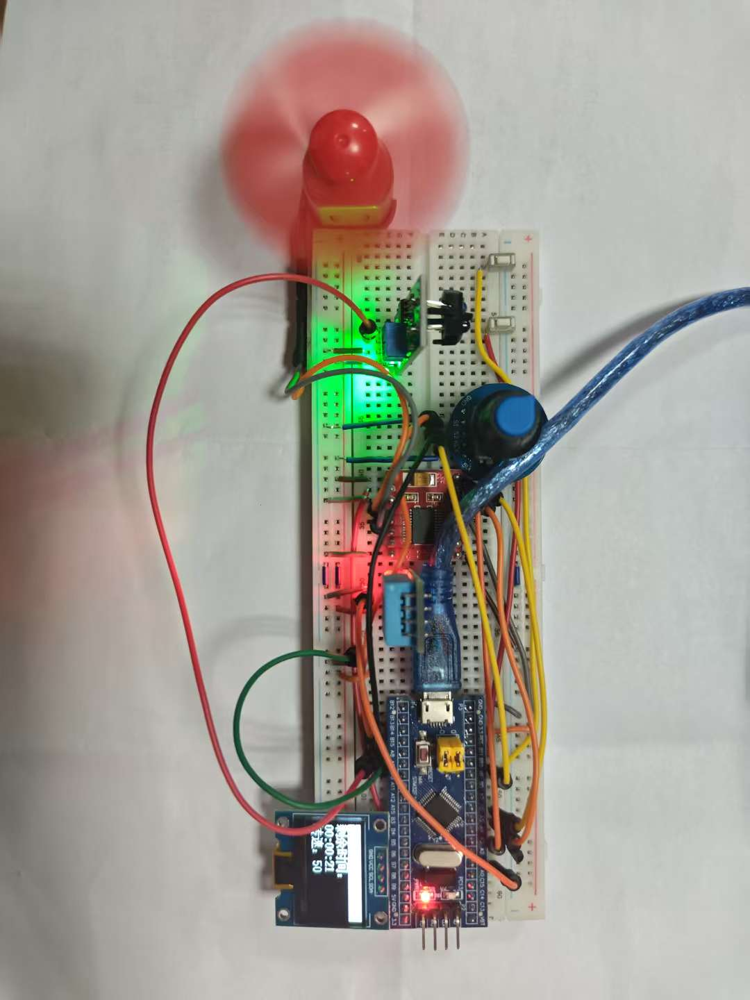</a> <strong>定时运行状态实拍</strong> 面包板、OLED 与风扇运行状态的历史照片。 Word 原报告 · image24.jpeg</td>
</tr>
</table>

<table>
<tr>
<td width="50%" align="center" valign="top"><a href="images/gallery/fan-25.jpeg">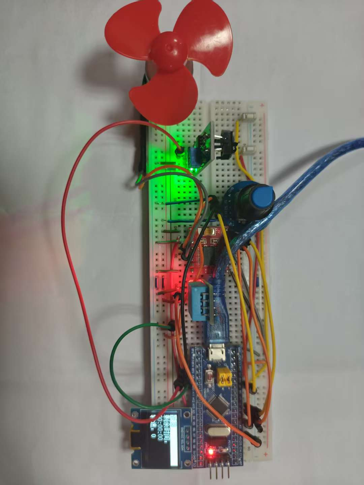</a> <strong>定时结束状态实拍</strong> 原报告标注的倒计时结束照片，保留为历史展示。 Word 原报告 · image25.jpeg</td>
<td width="50%" align="center" valign="top"><a href="images/gallery/fan-26.jpeg">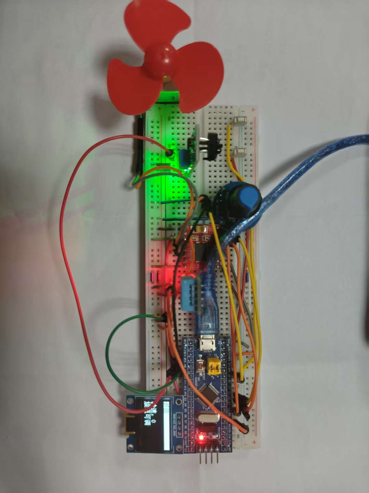</a> <strong>手动控制值为零的实拍</strong> 控制值用于 PWM 调节；不是通过转速传感器测得的 RPM。 Word 原报告 · image26.jpeg</td>
</tr>
</table>

<table>
<tr>
<td width="50%" align="center" valign="top"><a href="images/gallery/fan-27.jpeg">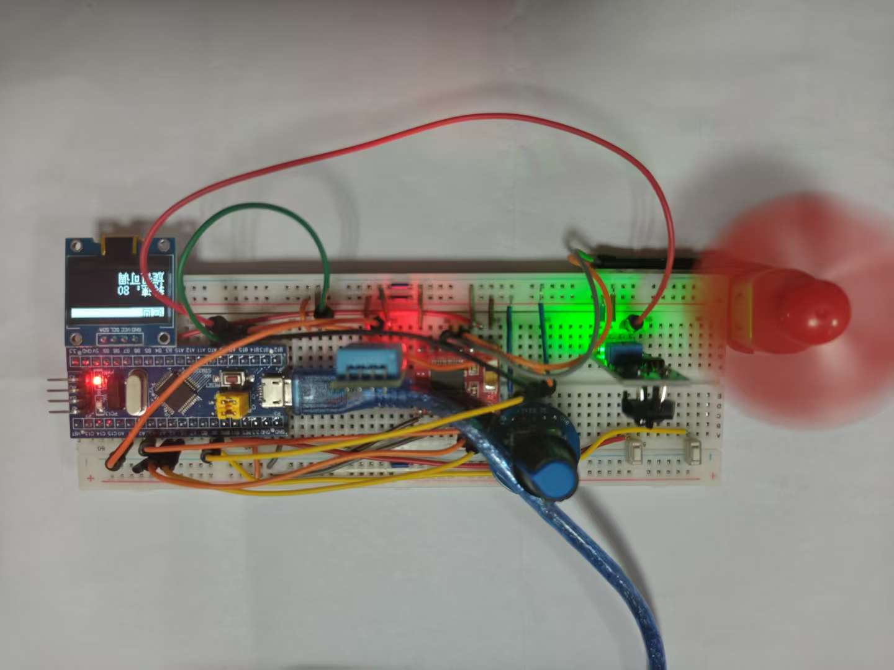</a> <strong>手动调速面包板实拍</strong> 展示电机、主控、编码器和 OLED；界面中的数值为控制值。 Word 原报告 · image27.jpeg</td>
<td width="50%" align="center" valign="top"><a href="images/gallery/fan-28.jpeg">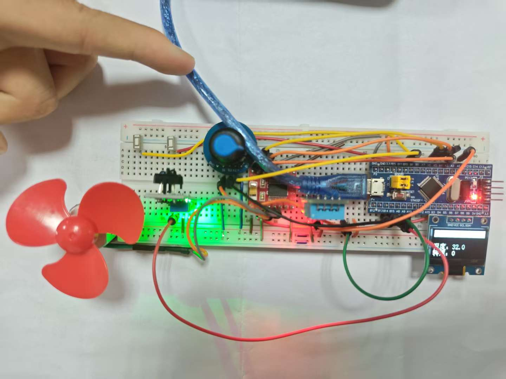</a> <strong>检测操作照片一</strong> 原报告标注 30mm 的操作场景；距离与触发效果未在本次独立测量。 Word 原报告 · image28.jpeg</td>
</tr>
</table>

<table>
<tr>
<td width="50%" align="center" valign="top"><a href="images/gallery/fan-29.jpeg">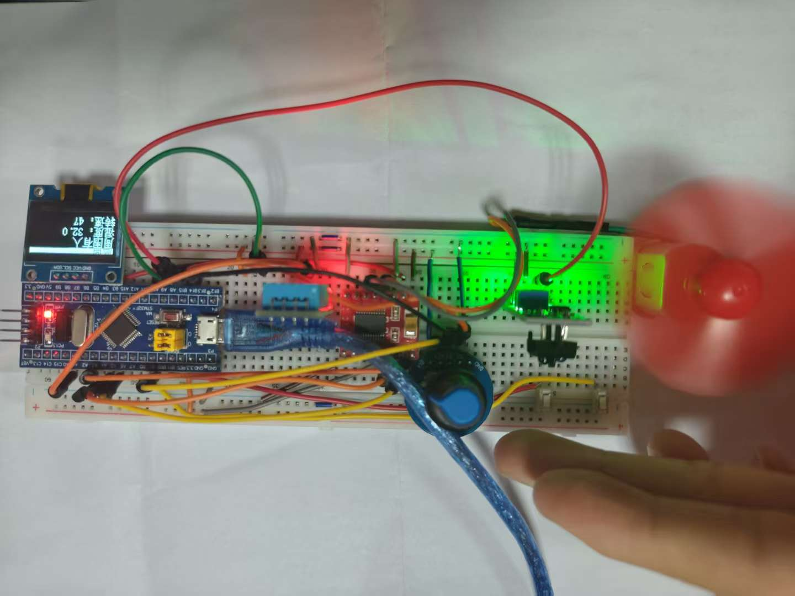</a> <strong>检测操作照片二</strong> 原报告标注 15mm 的操作场景，展示传感器门控操作。 Word 原报告 · image29.jpeg</td>
<td width="50%" align="center" valign="top"><a href="images/gallery/fan-30.jpeg">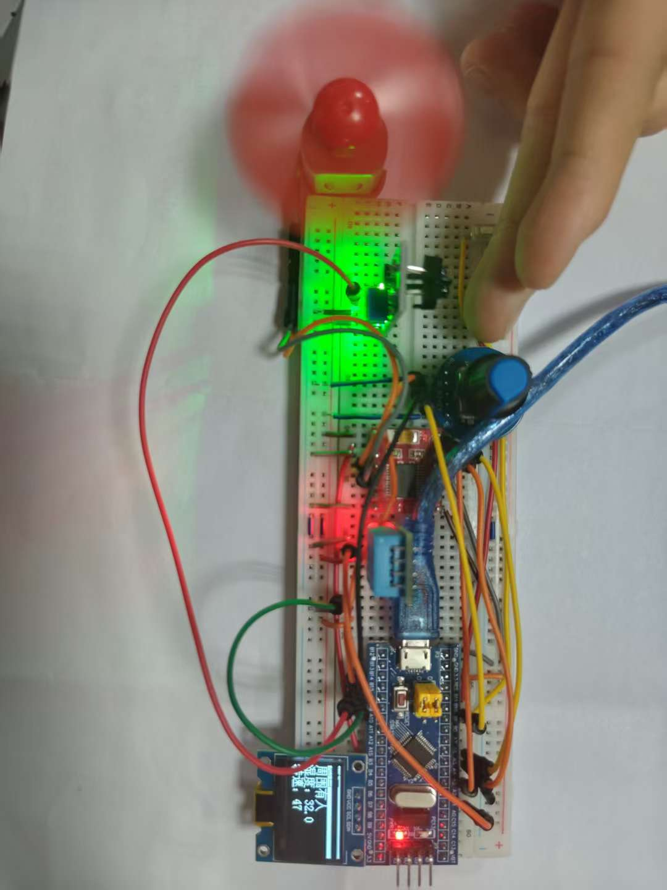</a> <strong>检测操作照片三</strong> 原报告标注 5mm 的操作场景，保留原始照片，不新增距离测试结论。 Word 原报告 · image30.jpeg</td>
</tr>
</table>

## 主控与外围电路

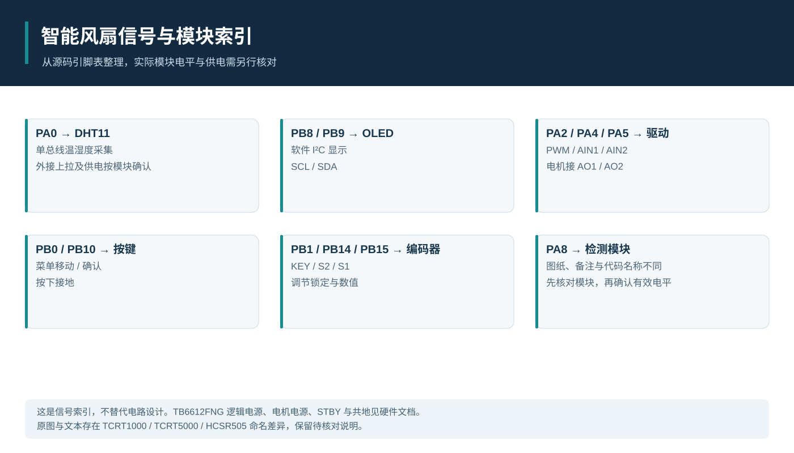

<table>
<tr>
<td width="50%" align="center" valign="top"><a href="images/gallery/fan-09.png">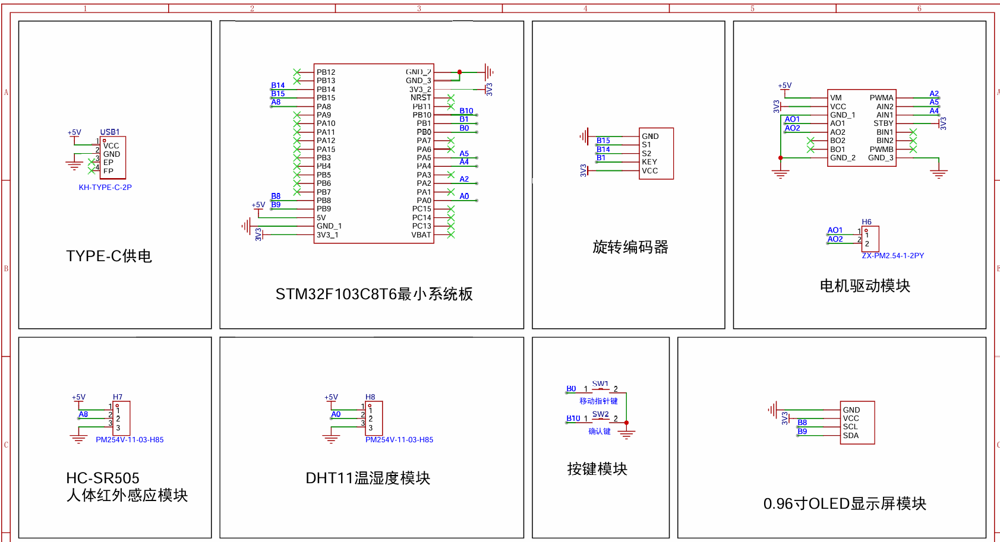</a> <strong>系统硬件模块电路总览</strong> 原报告电路图片，展示主控、接口和外围模块；保留原图内容，不作为本次电气验收。 Word 原报告 · image9.png</td>
<td width="50%" align="center" valign="top"><a href="images/gallery/fan-10.png">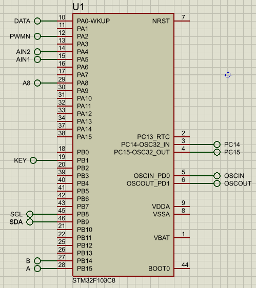</a> <strong>STM32 主控引脚连接</strong> 原报告的 MCU 连接图，使用前与源码引脚及实际板卡逐项核对。 Word 原报告 · image10.png</td>
</tr>
</table>

<table>
<tr>
<td width="50%" align="center" valign="top"><a href="images/gallery/fan-11.png">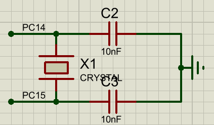</a> <strong>低速晶振原图</strong> 保留原报告截图中的元件值；晶振与负载电容需要结合实际芯片和电路复核。 Word 原报告 · image11.png</td>
<td width="50%" align="center" valign="top"><a href="images/gallery/fan-12.png">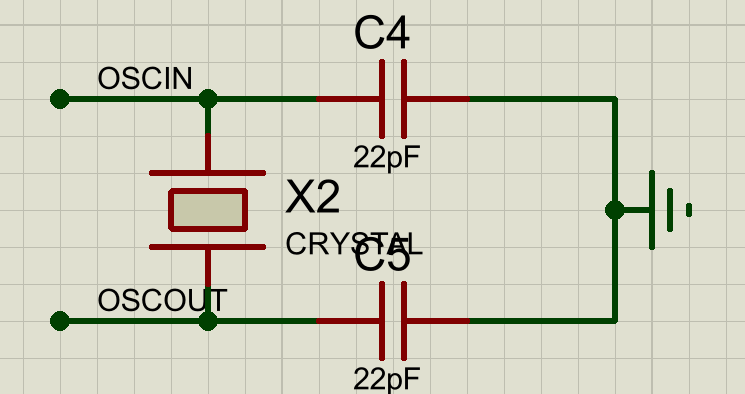</a> <strong>高速晶振原图</strong> 原资料的外部高速时钟电路截图。 Word 原报告 · image12.png</td>
</tr>
</table>

<table>
<tr>
<td width="50%" align="center" valign="top"><a href="images/gallery/fan-13.png">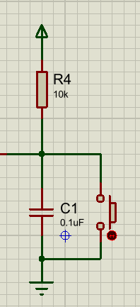</a> <strong>复位电路原图</strong> NRST 按键与外围电路截图。 Word 原报告 · image13.png</td>
<td width="50%" align="center" valign="top"><a href="images/gallery/fan-14.png">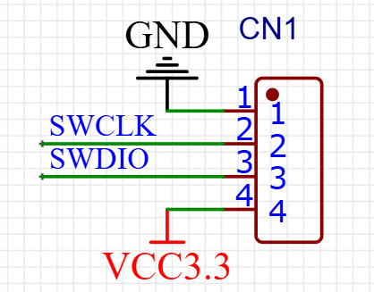</a> <strong>SWD 下载接口原图</strong> SWCLK、SWDIO、电源和地的接口示意。 Word 原报告 · image14.png</td>
</tr>
</table>

<table>
<tr>
<td width="50%" align="center" valign="top"><a href="images/gallery/fan-15.png">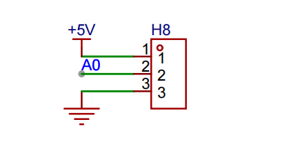</a> <strong>DHT11 接口原图</strong> 原图标注 5V 供电；与 3.3V 主控连接前应核对模块输出和上拉电压。 Word 原报告 · image15.png</td>
<td width="50%" align="center" valign="top"><a href="images/gallery/fan-16.png">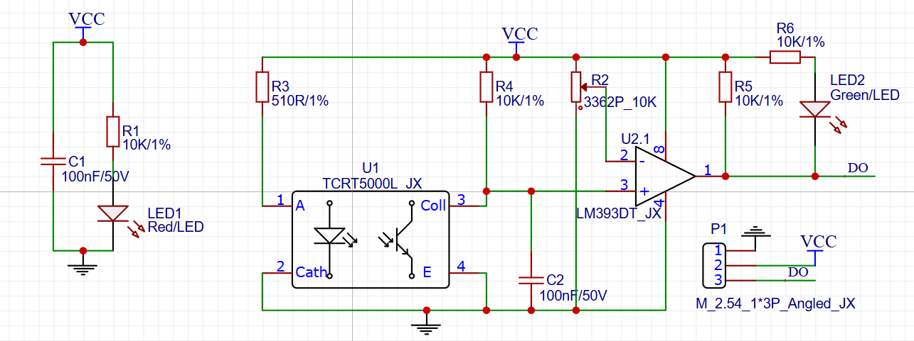</a> <strong>红外检测电路原图</strong> 原图的器件名称与正文、代码符号有差异，保留待核对说明。 Word 原报告 · image16.png</td>
</tr>
</table>

<table>
<tr>
<td width="50%" align="center" valign="top"><a href="images/gallery/fan-17.png">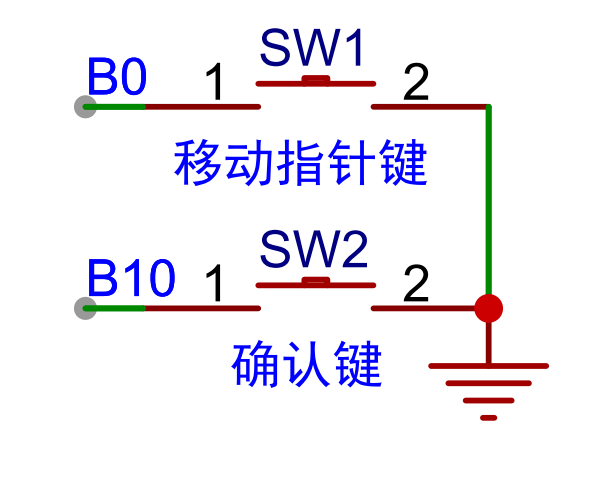</a> <strong>独立按键电路</strong> PB0 为菜单移动键，PB10 为确认键；原图按下接地。 Word 原报告 · image17.png</td>
<td width="50%" align="center" valign="top"><a href="images/gallery/fan-18.png">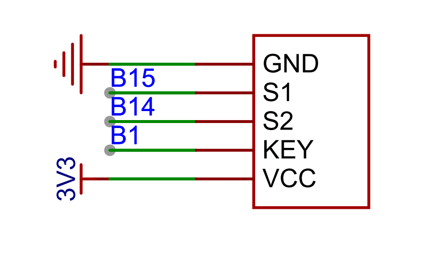</a> <strong>旋转编码器接口</strong> S1 / S2 / KEY 对应 PB15 / PB14 / PB1，用于调节与锁定。 Word 原报告 · image18.png</td>
</tr>
</table>

<table>
<tr>
<td width="50%" align="center" valign="top"><a href="images/gallery/fan-19.png">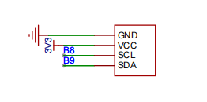</a> <strong>OLED 接口</strong> PB8 / PB9 对应软件 I²C 时钟与数据线。 Word 原报告 · image19.png</td>
<td width="50%" align="center" valign="top"><a href="images/gallery/fan-20.png">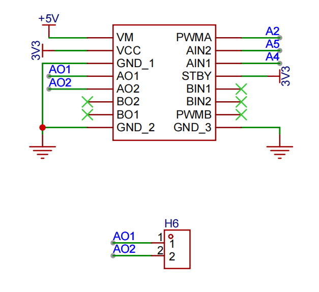</a> <strong>电机驱动连接原图</strong> 展示 TB6612FNG A 通道及电机端子，须结合硬件文档核对供电和 STBY。 Word 原报告 · image20.png</td>
</tr>
</table>

## 器件选型与备选方案

<table>
<tr>
<td width="50%" align="center" valign="top"><a href="images/gallery/fan-01.png">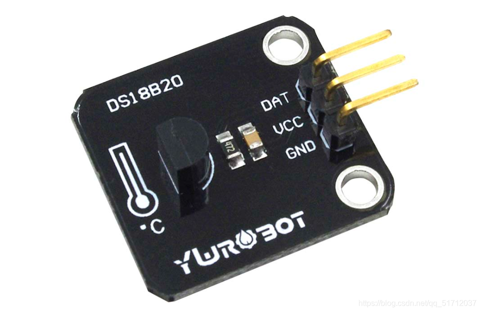</a> <strong>DS18B20 备选温度传感器</strong> 原报告的器件选型对比图；风扇公开源码采用 DHT11，不将此图当作已用器件。 Word 原报告 · image1.png</td>
<td width="50%" align="center" valign="top"><a href="images/gallery/fan-02.png">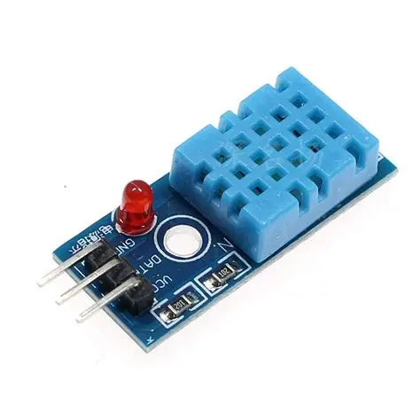</a> <strong>DHT11 温湿度模块</strong> 原报告所用温湿度采集模块示意，DATA 信号对应 PA0。 Word 原报告 · image2.png</td>
</tr>
</table>

<table>
<tr>
<td width="50%" align="center" valign="top"><a href="images/gallery/fan-03.jpeg">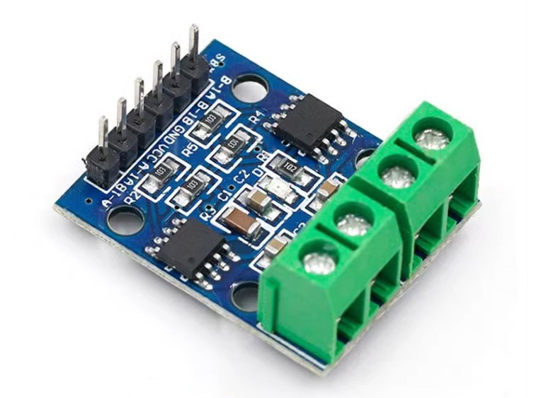</a> <strong>L9110S 备选驱动模块</strong> 器件选型对比图；本项目公开接线采用 TB6612FNG。 Word 原报告 · image3.jpeg</td>
<td width="50%" align="center" valign="top"><a href="images/gallery/fan-04.png">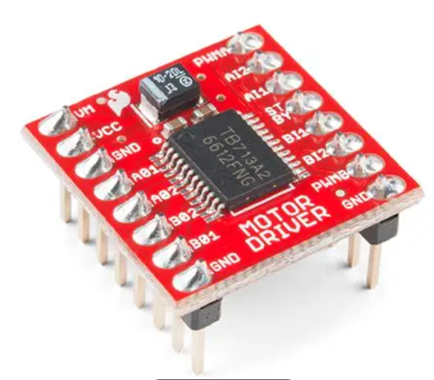</a> <strong>TB6612FNG 驱动模块</strong> 直流电机驱动模块图片，实际模块引脚定义仍需核对。 Word 原报告 · image4.png</td>
</tr>
</table>

<table>
<tr>
<td width="50%" align="center" valign="top"><a href="images/gallery/fan-05.png">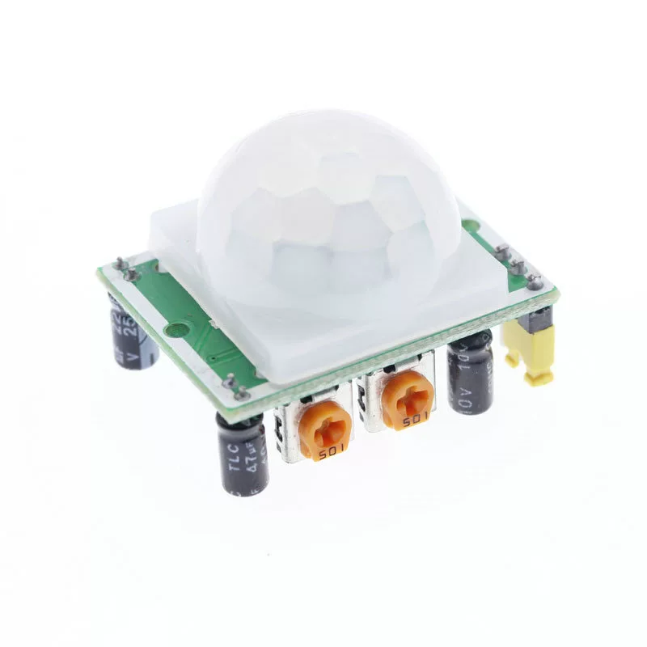</a> <strong>HC-SR501 备选红外模块</strong> 原报告的方案比较图；不是本仓库确认的实际装配模块。 Word 原报告 · image5.png</td>
<td width="50%" align="center" valign="top"><a href="images/gallery/fan-06.jpeg">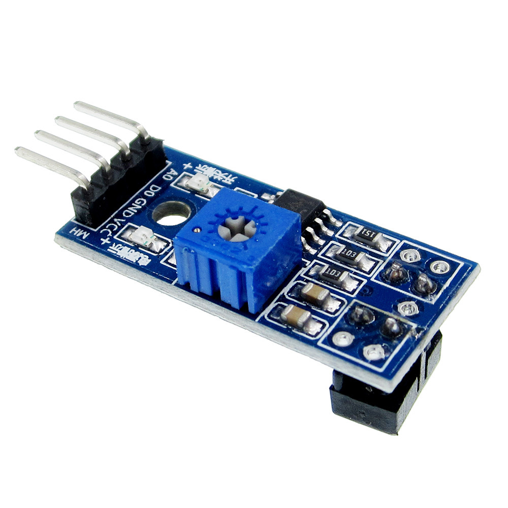</a> <strong>反射式红外模块图片</strong> 报告标注 TCRT5000，其他资料出现 TCRT1000 / HCSR505 名称，型号和有效电平待核对。 Word 原报告 · image6.jpeg</td>
</tr>
</table>

<table>
<tr>
<td width="50%" align="center" valign="top"><a href="images/gallery/fan-07.png">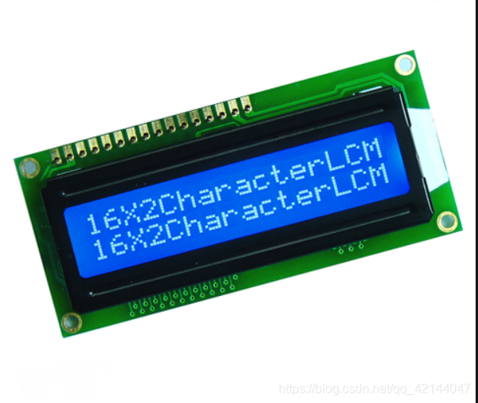</a> <strong>LCD1602 备选显示模块</strong> 选型比较图；本项目采用 OLED 显示。 Word 原报告 · image7.png</td>
<td width="50%" align="center" valign="top"><a href="images/gallery/fan-08.png">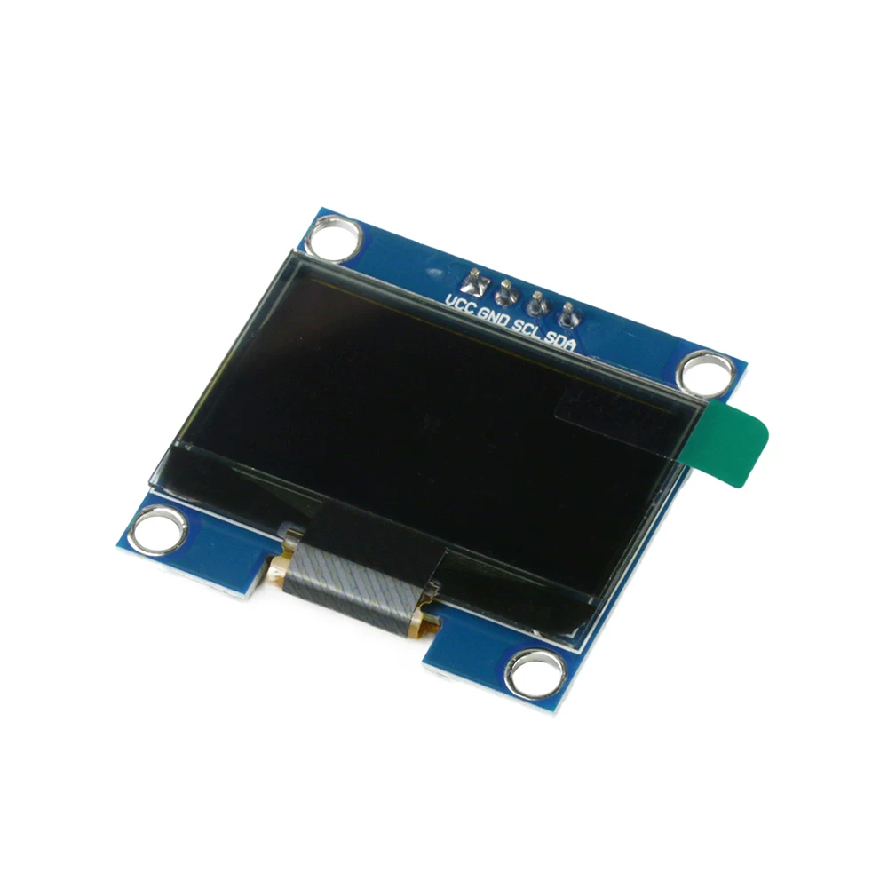</a> <strong>OLED 显示模块</strong> 0.96 寸四线接口模块图片，具体电平和驱动以硬件说明为准。 Word 原报告 · image8.png</td>
</tr>
</table>

## 开发与仿真历史截图

<table>
<tr>
<td width="50%" align="center" valign="top"><a href="images/gallery/fan-21.png">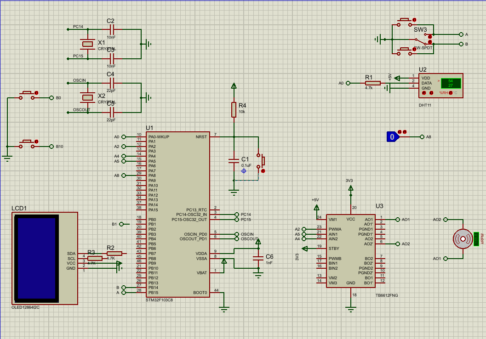</a> <strong>Proteus 电路历史截图</strong> 仅为原报告的仿真界面图片；当前仓库未提供可编辑仿真工程，也未在本次重新运行。 Word 原报告 · image21.png</td>
<td width="50%" align="center" valign="top"><a href="images/gallery/fan-22.png">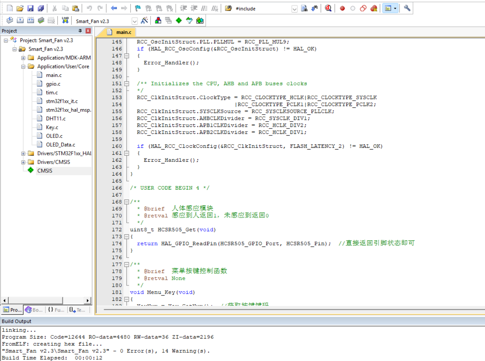</a> <strong>Keil 主函数与历史构建输出</strong> 原截图显示 0 errors、14 warnings；它不是本次图片更新重新构建得到的结果。 Word 原报告 · image22.png</td>
</tr>
</table>

## 阅读与验证边界

点击图片可查看完整大小。原文档未整体上传，标题页、姓名、学号、指导教师信息与文档元数据未纳入图集。结构图依据公开源码和现有资料绘制，表示功能关系，不能替代电气设计与实物验收。
